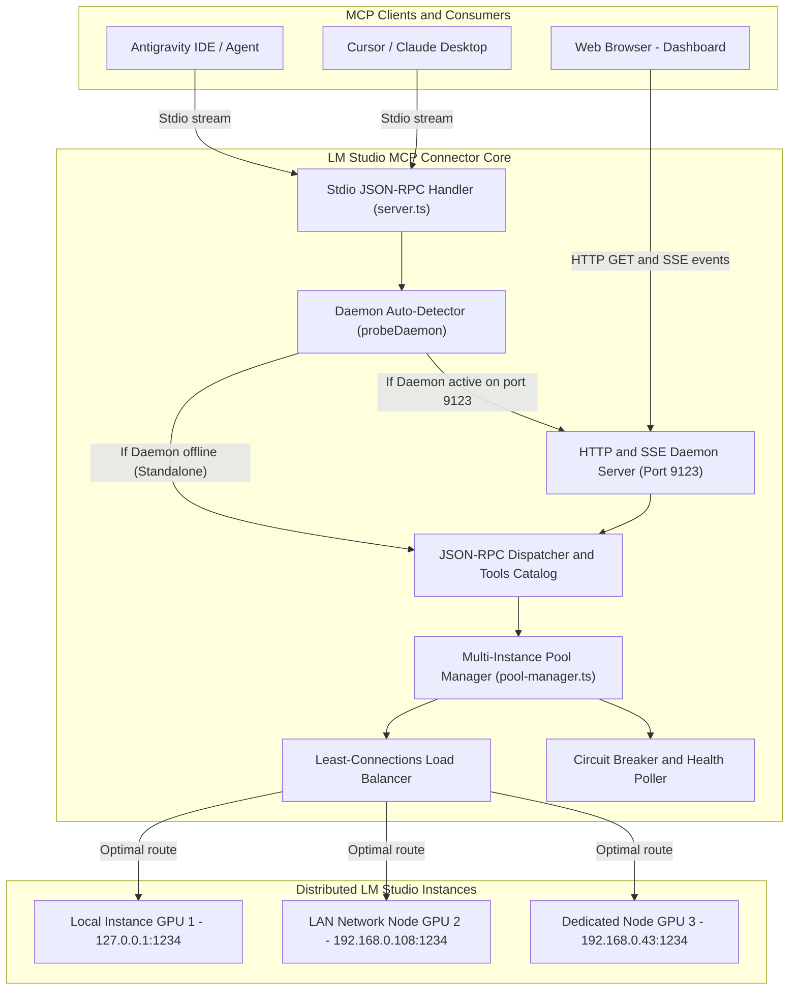

# System Architecture — Version 2.0.0

> 🤖 **AI Transparency & Disclosure**: Architectural documentation generated with Artificial Intelligence assistance (Google Antigravity / Gemini 3.8 Flash & LM Studio).

This document details the modular architecture of **LM Studio MCP Connector v2.0**, designed around clean separation of concerns and **zero external runtime dependencies**.

---

## 🏛️ Component Architecture Overview

---

## 🔄 Execution Flow & Transparent Bridge (Stdio ➔ Daemon)

Standard MCP servers run as isolated child processes for each client application. This prevents shared in-flight connection tracking, cluster-wide load balancing, and unified observability.

Version 2.0 solves this via its **transparent bridge**:

1. Antigravity spawns the standard command: `node dist/index.js`.
2. On startup, `McpServer.probeDaemon("http://127.0.0.1:9123")` sends a rapid HTTP probe (300ms timeout).
3. **Scenario A: The Daemon is running in the background**:
   - The Stdio process attaches to the active daemon.
   - Any JSON-RPC request (`initialize`, `tools/call`) is proxied over HTTP to `http://127.0.0.1:9123/mcp`.
   - The daemon executes the tool call across the shared multi-instance pool and broadcasts metrics via Server-Sent Events (SSE) to the Web Dashboard in real time.
4. **Scenario B: No Daemon is running**:
   - The connector runs immediately in standalone mode using its own local pool manager.

---

## 📦 Modular Codebase Structure

| Source File | Architectural Responsibility |
| :--- | :--- |
| `src/types.ts` | Strict TypeScript contracts: JSON-RPC 2.0, LM Studio DTOs, Pool interfaces, and fallback directives. |
| `src/config.ts` | Unified CLI flag parser, `.env` file resolution, and multi-instance parser. |
| `src/lmstudio-client.ts` | Isolated native HTTP client (`fetch`, `AbortController`) with health checks and dynamic model detection. |
| `src/pool-manager.ts` | Core resilience engine: instance registry, Least-Connections load balancer, failover, and Circuit Breaker. |
| `src/tools.ts` | Catalog of 5 MCP tools (`lmstudio_chat`, `lmstudio_health`, etc.) and safe execution handlers. |
| `src/server.ts` | Stdio JSON-RPC server with transparent HTTP daemon forwarding bridge. |
| `src/daemon-server.ts` | Native HTTP & SSE server (`node:http`) serving REST APIs, the `/mcp` RPC endpoint, and the embedded Web GUI. |
| `src/index.ts` | CLI entry point, argument router, and process lifecycle manager. |
