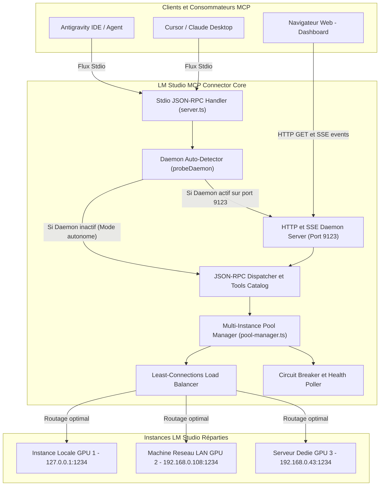

# Architecture Système — Version 2.0.0

> 🤖 **Avertissement / AI Transparency & Disclosure** : Document d'architecture généré avec l'assistance d'une Intelligence Artificielle (Google Antigravity / Gemini 3.8 Flash & LM Studio).

Ce document détaille l'architecture modulaire de **LM Studio MCP Connector v2.0**, basée sur une séparation stricte des responsabilités et une conception **zéro dépendance externe**.

---

## 🏛️ Vue d'Ensemble des Composants

---

## 🔄 Flux d'Exécution & Pont Transparent (Stdio ➔ Daemon)

Le problème classique des connecteurs MCP est que chaque client (Antigravity, Cursor) lance son propre processus indépendant en arrière-plan. Cela empêche de partager des métriques, de centraliser le load balancing ou d'observer les flux.

La version 2.0 résout cela grâce à son **pont transparent** :

1. Antigravity lance la commande standard `node dist/index.js`.
2. Au démarrage, `McpServer.probeDaemon("http://127.0.0.1:9123")` envoie un ping HTTP ultra-rapide (timeout 300ms).
3. **Cas A : Le daemon tourne en arrière-plan** :
   - Le sous-processus Stdio s'abonne au daemon.
   - Toute requête JSON-RPC (`initialize`, `tools/call`) est immédiatement transmise à `http://127.0.0.1:9123/mcp`.
   - Le daemon exécute la requête dans le pool multi-machines partagé et notifie en temps réel le Dashboard Web via Server-Sent Events (SSE).
4. **Cas B : Aucun daemon n'est lancé** :
   - Le connecteur bascule instantanément en mode autonome avec son propre gestionnaire de pool local.

---

## 📦 Organisation Modulaire du Code

| Fichier source | Rôle Architectural |
| :--- | :--- |
| `src/types.ts` | Contrats TypeScript stricts : JSON-RPC 2.0, DTOs LM Studio, interfaces du Pool et constantes de repli. |
| `src/config.ts` | Résolution unifiée des flags CLI, des variables d'environnement (`.env`) et parsing d'instances. |
| `src/lmstudio-client.ts` | Client HTTP natif (`fetch`, `AbortController`) avec sondes de latence et auto-détection des modèles. |
| `src/pool-manager.ts` | Orchestrateur de résilience : registre des instances, équilibrage *Least-Connections*, failover et circuit breaker. |
| `src/tools.ts` | Catalogue des 5 outils MCP (`lmstudio_chat`, `lmstudio_health`, etc.) et logique d'exécution sécurisée. |
| `src/server.ts` | Serveur Stdio JSON-RPC avec support du proxy HTTP transparent. |
| `src/daemon-server.ts` | Serveur HTTP/SSE natif (`node:http`) hébergeant l'API REST, le point d'entrée MCP HTTP et la GUI Web. |
| `src/index.ts` | Point d'entrée exécutable (CLI, `--daemon`, `--check-health`, stdio bridge). |
