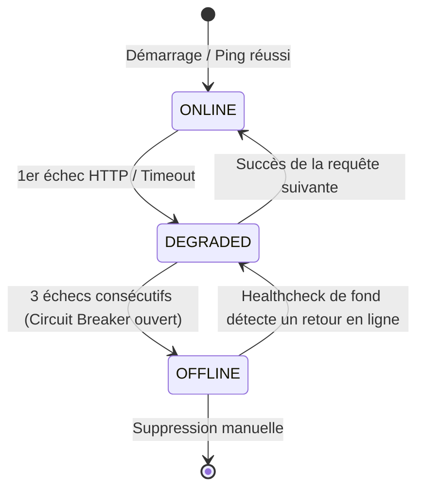

# Résilience, Failover & Repli vers LLM Distant

La résilience est au cœur de **LM Studio MCP Connector v2.0**. Une session de pair programming avec un agent IA ne doit jamais s'arrêter brutalement parce qu'une machine locale s'éteint ou redémarre.

---

## 🛡️ Les Niveaux de Protection



---

## 1. Failover Automatique Transparent (Machine A ➔ Machine B)

Lorsqu'une requête arrive (`executeWithFailover`) :
1. Le gestionnaire tente d'exécuter l'appel sur l'instance la plus disponible.
2. Si un incident survient (Machine injoignable, `ECONNREFUSED`, timeout dépassé) :
   - L'échec est comptabilisé pour cette instance.
   - Le connecteur logge l'avertissement.
   - **Il bascule instantanément sur la machine suivante éligible du pool**.
3. Pour le client (Antigravity ou Claude), la bascule est 100% invisible : la réponse arrive sans message d'erreur.

---

## 2. Circuit Breaker & Healthcheck de Fond

- **Seuil d'ouverture** : Si une instance cumule 3 échecs consécutifs (`maxConsecutiveFailures`), son circuit s'ouvre : son statut passe à `OFFLINE`.
- **Protection des requêtes** : Une instance `OFFLINE` est exclue de l'algorithme d'équilibrage de charge pour ne pas ralentir les requêtes suivantes.
- **Sonde de réhabilitation** : Un thread périodique en tâche de fond (`healthCheckIntervalMs`, par défaut toutes les 15s) sonde `/v1/models` sur les instances hors ligne. Dès qu'une machine redémarre, son statut repasse automatiquement à `ONLINE`.

---

## 3. Panne Totale & Directive de Repli vers LLM Distant (*Antigravity Remote Fallback*)

### La Problématique
Si toutes les machines LM Studio de votre réseau sont éteintes, que doit-il se passer ?
- **Comportement classique (mauvais)** : Le connecteur freeze avec un timeout infini ou crashe, bloquant complètement Antigravity et forçant l'utilisateur à relancer sa session.
- **Comportement v2.0 (optimal)** : Le connecteur retourne une directive claire et formelle incitant l'agent à prendre le relais avec ses modèles distants (Gemini, Claude, GPT).

### Le Format du Message de Repli
Dès qu'aucune instance locale n'est disponible, l'outil MCP renvoie `isError: true` avec le texte standardisé :

```text
⚠️ [LM STUDIO OFFLINE - REMOTE FALLBACK REQUIRED]
No local LM Studio instances are currently reachable.
Antigravity is instructed to immediately fulfill this user request using its native remote LLM capabilities without failing the turn.

Technical Cause:
All 3 LM Studio instances failed for role 'chat':
• instance-1 (http://127.0.0.1:1234): fetch failed (ECONNREFUSED)
• gpu-02 (http://192.168.0.108:1234): request timed out after 60000ms
• gpu-03 (http://192.168.0.43:1234): fetch failed (EHOSTUNREACH)
```

### Comportement de l'Agent Antigravity
En recevant ce bloc, Antigravity comprend que :
1. Les modèles locaux gratuits sont temporairement indisponibles.
2. Il ne doit pas interrompre la tâche de l'utilisateur.
3. Il doit immédiatement générer le code ou la réponse demandée avec son modèle distant propriétaire.
4. Dès que vous rallumez LM Studio, le connecteur détecte le retour en ligne et réactive la délégation gratuite locale.

