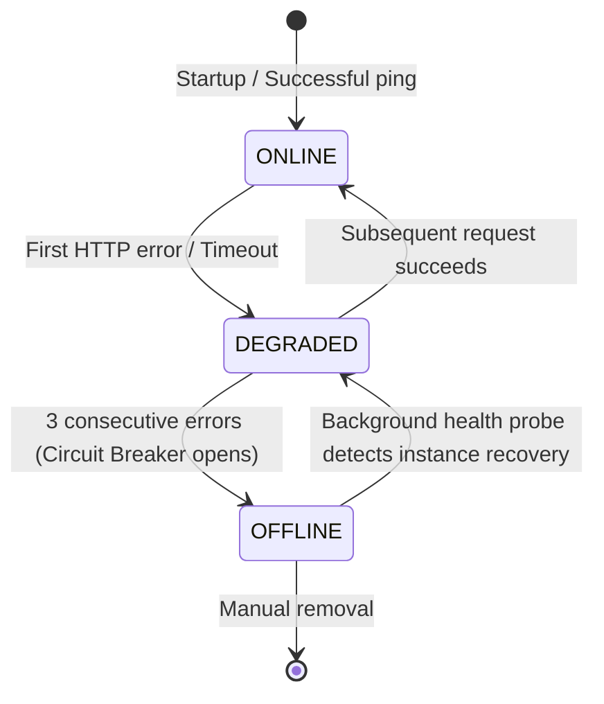

# Resilience, Failover & Remote Fallback

Resilience is a foundational principle of **LM Studio MCP Connector v2.0**. Pair programming sessions with AI agents must never crash or freeze because a local workstation reboots or disconnects.

---

## 🛡️ Protection Lifecycle



---

## 1. Seamless Automatic Failover (Node A ➔ Node B)

When a request executes (`executeWithFailover`):
1. The pool manager dispatches the call to the most available candidate instance.
2. If an error occurs (Connection refused, network timeout, 5xx status):
   - Failure metrics are recorded for that instance.
   - A warning is logged to `stderr`.
   - **The manager immediately retries the request on the next eligible instance in the pool**.
3. The calling AI client (Antigravity or Claude) experiences zero interruption and receives the valid completion seamlessly.

---

## 2. Circuit Breaker & Background Health Prober

- **Trip Threshold**: If an instance accumulates 3 consecutive failures (`maxConsecutiveFailures`), the circuit breaker trips and sets the instance to `OFFLINE`.
- **Worker Protection**: `OFFLINE` instances are excluded from active request routing to prevent adding latency to incoming queries.
- **Background Prober**: A non-blocking background loop (`healthCheckIntervalMs`, default 15s) continuously polls `/v1/models` on offline instances. Once LM Studio is restarted, the prober automatically restores the instance to `ONLINE`.

---

## 3. Total Outage & Antigravity Remote Fallback Directive

### The Challenge
What happens if all local LM Studio machines are powered down or unreachable?
- **Bad Behavior**: The connector hangs indefinitely, causing Antigravity to time out and forcing the developer to restart the session.
- **v2.0 Behavior**: The connector returns an explicit, structured directive instructing the agent to immediately fallback to its native remote LLMs.

### Fallback Message Specification
When all local nodes are down, the MCP tool returns `isError: true` containing:

```text
⚠️ [LM STUDIO OFFLINE - REMOTE FALLBACK REQUIRED]
No local LM Studio instances are currently reachable.
Antigravity is instructed to immediately fulfill this user request using its native remote LLM capabilities without failing the turn.

Technical Cause:
All 3 LM Studio instances failed for role 'chat':
• instance-1 (http://127.0.0.1:1234): fetch failed (ECONNREFUSED)
• gpu-02 (http://192.168.0.108:1234): request timed out after 60000ms
• gpu-03 (http://192.168.0.43:1234): fetch failed (EHOSTUNREACH)
```

### Agent Response
Upon receiving this payload, Antigravity understands that:
1. Free local models are temporarily unavailable.
2. It must not fail or abort the user's workflow.
3. It should fulfill the task directly using its remote cloud model (Gemini, Claude, GPT).
4. Once you bring LM Studio back online, the connector auto-recovers and restores free local delegation.
