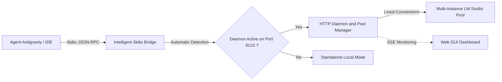

# Welcome to LM Studio MCP Connector Wiki

> 🤖 **AI Transparency & Disclosure**: This project and its complete documentation were architected, generated, and structured with Artificial Intelligence assistance (**Google Antigravity** — Model: *Gemini 3.8 Flash* & *LM Studio Local Models*).

**LM Studio MCP Connector** is a high-performance, strictly typed **Model Context Protocol (MCP)** server and daemon written in TypeScript (with zero runtime dependencies) designed to bridge agentic AI platforms (**Antigravity**, Claude Desktop, Cursor, Gemini) to local or distributed **LM Studio** instances.

---

## 🧭 Documentation Index

1. [Architecture Overview v2.0](Architecture-v2) — End-to-end component overview, Stdio/HTTP data flows, and the transparent bridge.
2. [Multi-Instance & Load Balancing](Multi-Instance-and-Load-Balancing) — PoolManager, Least-Connections load balancing, and role-based routing (`chat`, `embeddings`).
3. [Resilience & Remote Fallback](Failover-and-Resilience) — Circuit Breaker, seamless failover, and the Antigravity Remote Fallback Directive.
4. [Web GUI Dashboard](Web-GUI-Dashboard) — Real-time monitoring web dashboard, Server-Sent Events (SSE), and REST API.
5. [Configuration & Deployment](Configuration-and-Deployment) — CLI options, environment variables, Antigravity integration, and multi-OS installation.
6. [Governance, Skills & Engineering Rules](Skills-Agents-and-Rules) — AGENTS.md standards, skill catalog, AI disclosure, and automated Quality Gate.
7. [Roadmap & Future Evolutions](Roadmap-and-Future-Evolutions) — Next milestones: MCP Prompts and Local Vector RAG.

---

## 🌟 Version 2.0.0 Core Principles

- **Maximized Free Local Inferences**: Delegate 100% of heavy reasoning and code generation to free local models.
- **Continuous Resilience**: If all local instances are offline, Antigravity immediately receives instructions to complete tasks using remote LLMs.
- **Zero Runtime Dependencies**: Exclusively powered by native Node.js APIs (`node:http`, `node:events`, `fetch`, `readline`, `AbortController`).
