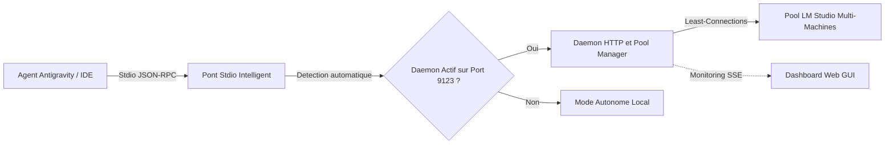

# Bienvenue sur le Wiki LM Studio MCP Connector

**LM Studio MCP Connector** est un serveur et daemon **Model Context Protocol (MCP)** en TypeScript strict (zéro dépendance runtime) conçu pour interconnecter les plateformes agentiques (**Antigravity**, Claude Desktop, Cursor, Gemini) à des instances locales ou réparties de **LM Studio**.

---

## 🧭 Sommaire de la Documentation

1. [Architecture Système v2.0](Architecture-v2) — Vue globale du système, flux de données Stdio/HTTP et pont transparent.
2. [Multi-Instances & Load Balancing](Multi-Instance-and-Load-Balancing) — Gestion du pool, algorithme *Least-Connections* et routage par rôle (`chat`, `embeddings`).
3. [Résilience & Repli Distant](Failover-and-Resilience) — Circuit Breaker, bascule transparente et directive de repli distant Antigravity (*Remote Fallback*).
4. [Dashboard Web & Monitoring](Web-GUI-Dashboard) — Interface Web de monitoring en temps réel, Server-Sent Events (SSE) et API REST.
5. [Configuration & Déploiement](Configuration-and-Deployment) — Options CLI, variables d'environnement, configuration Antigravity et multi-OS.
6. [Feuille de Route & Évolutions](Roadmap-and-Future-Evolutions) — Prochaines étapes : MCP Prompts prédéfinis et RAG local vectoriel.

---

## 🌟 Principes Fondamentaux de la Version 2.0.0

- **Économie Maximale de Tokens Payants** : Déleguer 100% du travail cognitif et du code aux modèles locaux gratuits.
- **Résilience Totale** : Continuité de service assurée : si toutes les machines locales sont éteintes, Antigravity reçoit immédiatement l'instruction de basculer sur ses LLMs distants.
- **Zéro Dépendance Runtime** : Conçu exclusivement avec les modules natifs Node.js (`node:http`, `node:events`, `fetch`, `readline`, `AbortController`).
