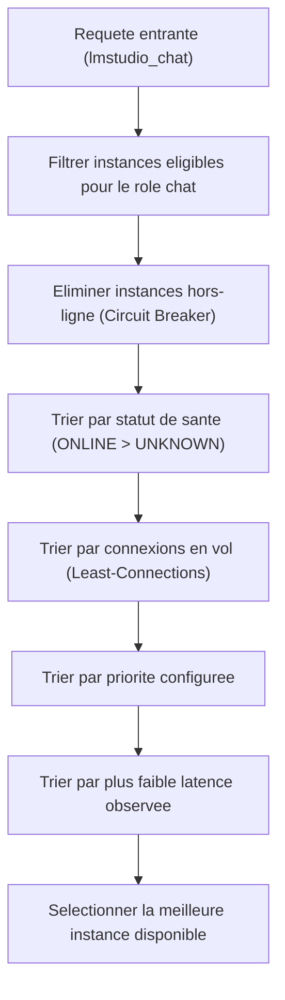

# Multi-Instances & Répartition de Charge (Load Balancing)

> 🤖 **Avertissement / AI Transparency & Disclosure** : Document d'architecture généré avec l'assistance d'une Intelligence Artificielle (Google Antigravity / Gemini 3.8 Flash & LM Studio).

La version 2.0.0 de **LM Studio MCP Connector** permet d'agréger plusieurs machines ou serveurs exécutant LM Studio dans un cluster virtuel unifié.

---

## 🎯 Objectifs de la Répartition

1. **Supprimer le goulot d'étranglement GPU unique** : Répartir les requêtes lourdes (génération de code, revue de refactoring) sur plusieurs GPUs distincts.
2. **Spécialiser les flux par rôle** : Ne pas bloquer la génération de texte avec des calculs d'embeddings fréquents.
3. **Zéro configuration complexe** : Pas besoin de Nginx, de HAProxy ou de Kubernetes.

---

## 🏷️ Définition des Rôles par Instance

Chaque instance déclarée dans le pool se voit attribuer un ou plusieurs rôles :

| Rôle | Description | Outils MCP Routés |
| :--- | :--- | :--- |
| `chat` | Modèles de génération de texte / code (ex: Qwen 2.5 Coder, Gemma, Llama). | `lmstudio_chat` |
| `embeddings` | Modèles de vectorisation rapide (ex: `nomic-embed-text`, `bge-m3`). | `lmstudio_embeddings` |
| `all` | Traite indifféremment le chat et les embeddings. | Tous les outils |

---

## ⚖️ Algorithme Least-Connections

Pour éviter d'envoyer une requête à un GPU déjà à 100% d'utilisation sur une complétion longue, le `PoolManager` applique l'algorithme suivant lors de l'appel `selectCandidates(role)` :



### Exemple de comportement
Si `Instance A` traite déjà 1 requête (`inFlightRequests: 1`) et `Instance B` est libre (`inFlightRequests: 0`), la nouvelle requête est immédiatement routée vers `Instance B`.

---

## ⚙️ Configuration Multi-Instances

### Via la Ligne de Commande (Format court ou JSON)
```bash
# Format URLs séparées par des virgules (toutes avec rôle "all") :
node dist/index.js --instances "http://127.0.0.1:1234,http://192.168.0.108:1234,http://192.168.0.43:1234"

# Format JSON avancé (rôles et priorités spécifiques) :
node dist/index.js --instances '[
  {"id":"gpu-local","url":"http://127.0.0.1:1234","roles":["all"],"priority":2},
  {"id":"gpu-lan-1","url":"http://192.168.0.108:1234","roles":["all"],"priority":1},
  {"id":"gpu-lan-2","url":"http://192.168.0.43:1234","roles":["chat"],"priority":1}
]'
```

### Via les Variables d'Environnement (`.env`)
```env
LMSTUDIO_INSTANCES=[{"id":"gpu-01","url":"http://127.0.0.1:1234","roles":["all"]},{"id":"gpu-02","url":"http://192.168.0.108:1234","roles":["all"]}]
```

### Directement depuis le Dashboard Web
Sur `http://127.0.0.1:9123/`, remplissez le formulaire "Ajouter une Nouvelle Instance" : l'instance est injectée à chaud dans le pool sans redémarrer le daemon.
