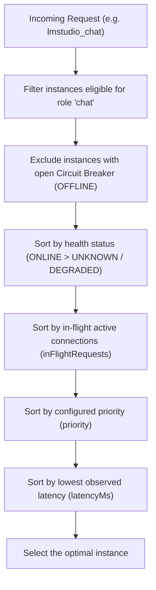

# Multi-Instance & Load Balancing

Version 2.0.0 of **LM Studio MCP Connector** aggregates multiple machines and GPUs running LM Studio into a unified, high-availability cluster.

---

## 🎯 Objectives

1. **Eliminate Single-GPU Bottlenecks**: Distribute heavy workloads (large-scale code generation, refactoring, test suites) across multiple GPUs.
2. **Role Specialization**: Separate fast vector embedding computations from deep code generation tasks.
3. **Zero Complex Setup**: No Nginx, HAProxy, or Kubernetes required; runs natively on Node.js.

---

## 🏷️ Role Definitions per Instance

Each instance declared in the pool can be tagged with one or multiple roles:

| Role | Description | Routed MCP Tools |
| :--- | :--- | :--- |
| `chat` | Code and chat completion models (e.g. Qwen 2.5 Coder, Gemma, Llama). | `lmstudio_chat` |
| `embeddings` | Fast text vectorization models (e.g. `nomic-embed-text`, `bge-m3`). | `lmstudio_embeddings` |
| `all` | Generalist node handling both chat completions and embeddings. | All tools |

---

## ⚖️ Least-Connections Algorithm

To prevent sending requests to a GPU already saturated with a long completion, `PoolManager` selects candidates using the following pipeline:



### Example Behavior
If `Instance A` is processing 1 active request (`inFlightRequests: 1`) and `Instance B` is idle (`inFlightRequests: 0`), the new request is dispatched to `Instance B`.

---

## ⚙️ Multi-Instance Configuration

### Via CLI Arguments (Comma-Separated or JSON)
```bash
# Comma-separated URLs (all tagged with role "all"):
node dist/index.js --instances "http://127.0.0.1:1234,http://192.168.0.108:1234,http://192.168.0.43:1234"

# Advanced JSON format (custom roles and priorities):
node dist/index.js --instances '[
  {"id":"gpu-local","url":"http://127.0.0.1:1234","roles":["all"],"priority":2},
  {"id":"gpu-lan-1","url":"http://192.168.0.108:1234","roles":["all"],"priority":1},
  {"id":"gpu-lan-2","url":"http://192.168.0.43:1234","roles":["chat"],"priority":1}
]'
```

### Via Environment Variables (`.env`)
```env
LMSTUDIO_INSTANCES=[{"id":"gpu-01","url":"http://127.0.0.1:1234","roles":["all"]},{"id":"gpu-02","url":"http://192.168.0.108:1234","roles":["all"]}]
```

### Via the Embedded Web Dashboard
Navigate to `http://127.0.0.1:9123/` and use the "Add a New Instance" form: new instances are injected into the active pool with zero downtime.
