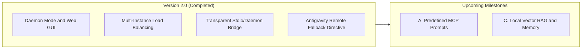

# Roadmap & Future Evolutions

> 🤖 **AI Transparency & Disclosure**: Architectural documentation generated with Artificial Intelligence assistance (Google Antigravity / Gemini 3.8 Flash & LM Studio).

This page outlines the planned future milestones for the connector, focusing on continuous reduction of paid token consumption for agentic workflows.

---

## 🗺️ Milestone Matrix

| Milestone | Status | Description |
| :--- | :--- | :--- |
| **Version 2.0 Core** | ✅ Completed | Daemon mode, live Web GUI, multi-instance pool, failover, and transparent fallback. |
| **A. Predefined MCP Prompts** | 🔄 Ready to Start | Standardized code review, DDD refactoring, and test generation prompt templates. |
| **C. Local Vector RAG & Memory** | 📅 Scheduled | Local vector store with model-partitioned collections and multi-instance embedding routing. |

---

## 1. Milestone A: Predefined MCP Prompts (Next Step)

### Objective
Provide standard MCP prompt templates (`prompts/list` and `prompts/get`) so calling agents (Antigravity, Gemini, Claude) can trigger pre-optimized prompt templates for local models without spending remote tokens authoring verbose instructions.

### Planned Prompts
- `review-code`: Comprehensive code review and bug inspection with `code` and `language` arguments.
- `refactor-clean-code-ddd`: Architectural refactoring following Clean Architecture and DDD standards.
- `generate-unit-tests`: Complete unit test suite generation for a specified class or module.
- `diagnose-compiler-error`: Rapid diagnosis of TypeScript or Python compiler errors with concrete patches.

---

## 2. Milestone C: Local Vector RAG & Memory

### Objective
Equip agents with native tools to index codebase files into vector embeddings and perform local semantic search without transmitting large codebases to remote cloud LLMs.

### Key Specifications
- **Zero Third-Party Database Dependencies**: Built on lightweight native storage (`node:sqlite` or persistent JSON vector store).
- **Partitioning by Embedding Model**: Vector collections are strictly tied to their generating model ID (`collection.model_id`) to prevent vector space corruption when models change.
- **Multi-Instance Capability Routing**: Embedding generation is delegated to instances tagged with the `embeddings` role, keeping code completion instances responsive.
- **Dedicated MCP Tools**: `lmstudio_rag_index` and `lmstudio_rag_search`.
