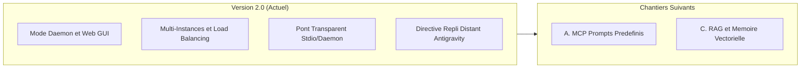

# Feuille de Route & Évolutions Futures

Cette page documente les axes d'évolutions prioritaires planifiés pour le connecteur, dans l'objectif continu de minimiser la consommation de crédits payants pour les plateformes agentiques.

---

## 🗺️ Matrice des Chantiers

| Chantier | Statut | Description |
| :--- | :--- | :--- |
| **Version 2.0 Core** | ✅ Terminé | Mode Daemon, GUI Web temps réel, Multi-Instances, Failover et Fallback transparent. |
| **A. MCP Prompts Prédéfinis** | 🔄 Prêt à démarrer | Gabarits de code/tests/refactoring DDD réduisant les tokens de prompt. |
| **C. RAG & Mémoire Vectorielle** | 📅 Planifié | Store vectoriel local avec partitionnement par modèle d'embeddings. |

---

## 1. Chantier A : MCP Prompts Prédéfinis (Prochaine Étape)

### Objectif
Permettre aux orchestrateurs (Antigravity, Gemini, Claude) d'invoquer des gabarits de prompts spécialisés et optimisés pour les modèles locaux sans consommer de tokens d'orchestration pour formuler les consignes.

### Prompts Envisagés
- `review-code` : Analyse qualité, recherche de bugs et respect des normes avec paramètres `code` et `language`.
- `refactor-clean-code-ddd` : Restructuration de code selon les patterns DDD et Clean Architecture.
- `generate-unit-tests` : Génération complète de tests unitaires pour une fonction ou une classe.
- `diagnose-compiler-error` : Analyse des erreurs de compilation TypeScript/Python et proposition de correctif immédiat.

---

## 2. Chantier C : RAG & Mémoire Vectorielle Locale

### Objectif
Fournir aux agents un outil MCP d'indexation vectorielle du code et de recherche sémantique locale sans faire transiter de gros volumes de code à travers le modèle distant.

### Spécifications Clés
- **Stockage léger sans dépendance externe** (SQLite natif `node:sqlite` ou store JSON persistant).
- **Partitionnement par modèle d'embedding** : Chaque collection d'index est liée au modèle qui l'a créée (`collection.model_id`) pour éviter les incohérences dimensionnelles lors des changements dynamiques de modèle.
- **Délégation multi-instances** : Les requêtes d'indexation vectorielle utilisent l'instance du pool taggée avec le rôle `embeddings`, garantissant que les calculs de vecteurs ne ralentissent pas la génération de code.
- **Outils MCP dédiés** : `lmstudio_rag_index` et `lmstudio_rag_search`.
