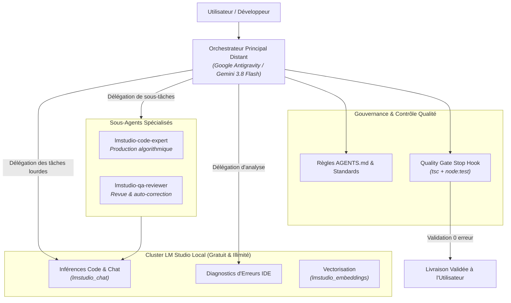
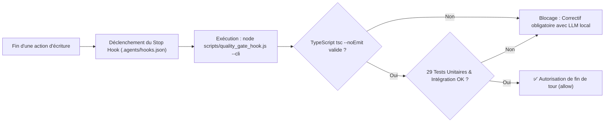

# Gouvernance des Agents, Skills & Règles d'Ingénierie

> 🤖 **Avertissement / AI Transparency & Disclosure** : Document généré et structuré avec l'assistance d'une Intelligence Artificielle (Google Antigravity / Gemini 3.8 Flash & LM Studio).

Ce document formalise les règles d'ingénierie, les compétences spécialisées (*Skills*), les hooks de cycle de vie et l'organisation multi-agents appliqués sur le projet **LM Studio MCP Connector**.

---

## 🏛️ 1. Règles d'Ingénierie Systématiques (`AGENTS.md`)

Le projet applique un standard d'ingénierie strict, codifié dans [`AGENTS.md`](file:///e:/SourceCode/LMStudio_MCP_Connector/AGENTS.md) et vérifié de manière continue.

### A. Règle d'Économie Maximale : Délégation au LLM Local Gratuit
- **Principe fondamental** : Les tokens du modèle distant (Gemini, Claude, GPT) sont payants, tandis que les tokens de LM Studio local sont **100% gratuits, illimités et confidentiels**.
- **Répartition des rôles** : Le modèle distant agit uniquement comme un **coordinateur léger**. Tout le calcul lourd (génération de code, refactoring, audit qualité, analyse d'erreurs IDE, brainstorming) est délégué au modèle local via `lmstudio_chat`.
- **Propagation aux sous-agents** : Tout sous-agent invoqué ou défini doit obligatoirement avoir `enable_mcp_tools=true` et la consigne expresse de sous-traiter ses calculs à LM Studio.

### B. Règle Obligatoire de Transparence IA (AI Disclosure)
- Tout fichier créé ou modifié (TypeScript, JavaScript, scripts Shell, PowerShell, README, pages Wiki) **DOIT obligatoirement comporter une mention d'avertissement** de génération assistée par IA, spécifiant les modèles intervenants (*Google Antigravity / Gemini 3.8 Flash & LM Studio local*).
- Référence : [`.agents/rules/ai-transparency-disclosure.md`](file:///e:/SourceCode/LMStudio_MCP_Connector/.agents/rules/ai-transparency-disclosure.md).

### C. Standards d'Architecture TypeScript & Zéro Dépendance Runtime
- **Typage Strict** : `strict: true`, `noImplicitAny: true`, `noUncheckedIndexedAccess: true`, `exactOptionalPropertyTypes: true`. Aucun usage de `any`.
- **Zéro Dépendance Runtime Externe** : Le serveur, le client et le daemon s'appuient exclusivement sur les modules natifs Node.js (`node:http`, `node:events`, `node:readline`, `node:fs`, `node:path`, `fetch`, `AbortController`). Empreinte mémoire minimale et zéro vulnérabilité CVE.

### D. Quality Gate Automatisé & Stop Hook
- Avant de conclure toute intervention ou tout tour d'agent, le script [`scripts/quality_gate_hook.js`](file:///e:/SourceCode/LMStudio_MCP_Connector/scripts/quality_gate_hook.js) s'exécute automatiquement via le Stop Hook (`.agents/hooks.json`).
- Si une seule erreur TypeScript (`tsc --noEmit`) ou un seul test unitaire échoue, la fin du tour est bloquée jusqu'à résolution complète.

---

## 🧩 2. Catalogue des Skills Activés (`.agents/skills/`)

Les *Skills* étendent les compétences de l'agent avec des runbooks et des pratiques spécialisées :

| Skill | Domaine | Description & Rôle |
| :--- | :--- | :--- |
| **`qa-code-reviewer`** | Qualité & Tests | Déclenche automatiquement le Quality Gate (`tsc --noEmit` et suites de tests) après toute modification de code. |
| **`lmstudio`** | LLM Local | Accès direct et requêtes au modèle local LM Studio via le protocole MCP. |
| **`typescript-vite-expert`** | Modern TypeScript | Bonnes pratiques TypeScript 5.7+, modules ESM natifs, typage strict et patterns asynchrones. |
| **`security-cve-hardening`** | Sécurité & Anti-Vulnérabilités | Audits de sécurité, gestion zéro-trust, validation des entrées et exécution sécurisée de commandes système. |
| **`cloud-native-resilience`** | Résilience & Tolérance aux pannes | Implémentation des timeouts stricts (`AbortController`), Circuit Breaker, failover et arrêt gracieux (`SIGINT`/`SIGTERM`). |
| **`cloud-native-observability`** | Télémétrie & Logs | Traces structurées sur `stderr`, calcul de latence par requête et corrélation des identifiants JSON-RPC. |
| **`cloud-native-scalability`** | Haute Disponibilité & Scaling | Conception stateless, gestion de pools multi-instances et répartition de charge *Least-Connections*. |
| **`ddd-strategic-design`** | Stratégie DDD | Découpage en contextes délimités (*Bounded Contexts*), langage ubiquitaire et architecture en couches. |
| **`ddd-tactical-patterns`** | Patterns Tactiques DDD | Modélisation d'entités riches, objets valeurs typés (*Value Objects*), événements de domaine et agrégats. |
| **`python-expert-dev`** | Environnement Python | Standards de développement Python 3.14+ (si composants Python connectés). |
| **`python-layer-architecture`** | Architecture 4 Couches | Organisation en couches Présentation, Application, Domaine et Infrastructure. |

---

## 🤖 3. Modèle d'Orchestration Multi-Agents

Le système repose sur une hiérarchie collaborative optimisée pour le coût et la performance :



### Rôles des Sous-Agents Dédiés
1. **`lmstudio-code-expert`** : Invoqué pour générer du code complexe, des fonctions d'algorithmique ou des composants sans consommer de tokens sur le modèle payant.
2. **`lmstudio-qa-reviewer`** : Invoqué en cas d'erreur de compilation ou de régression de test pour analyser l'extrait fautif avec le LLM local et formuler le correctif exact.

---

## 🔄 4. Le Quality Gate Automatisé en Action

Le Stop Hook assure qu'aucun code non fonctionnel ne peut être validé :



### Commandes de Contrôle Manuel
Pour vérifier l'état du Quality Gate à tout moment dans le terminal :
```bash
node scripts/quality_gate_hook.js --cli
```
