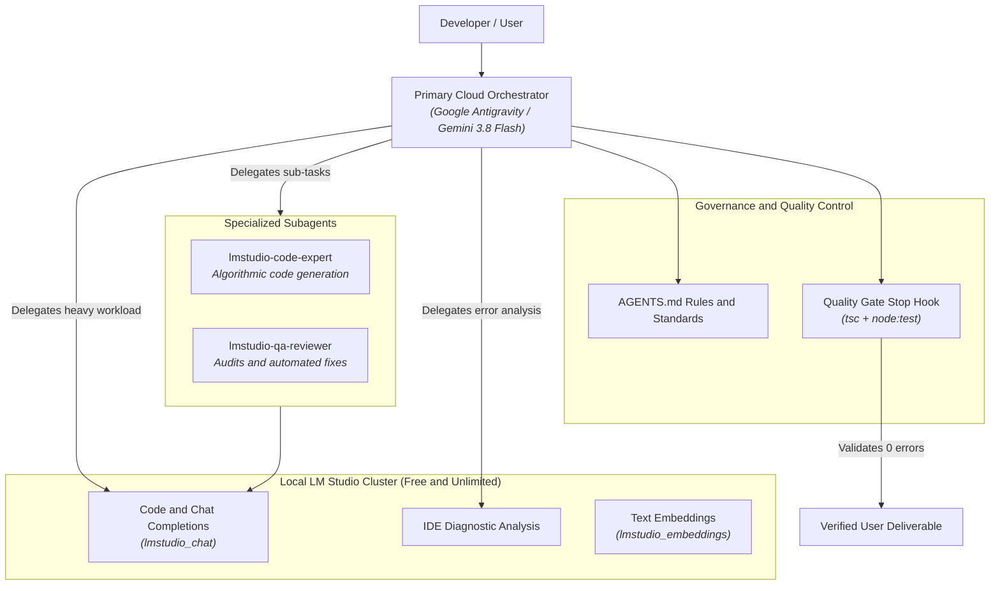
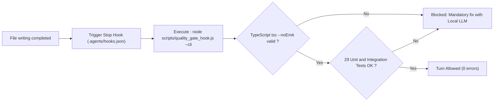

# Agent Governance, Skills & Engineering Rules

> 🤖 **AI Transparency & Disclosure**: Document generated and structured with Artificial Intelligence assistance (Google Antigravity / Gemini 3.8 Flash & LM Studio).

This document formalizes the engineering rules, specialized competencies (*Skills*), lifecycle hooks, and multi-agent architecture applied across the **LM Studio MCP Connector** project.

---

## 🏛️ 1. Core Engineering Standards (`AGENTS.md`)

The project adheres to strict engineering rules codified in [`AGENTS.md`](file:///e:/SourceCode/LMStudio_MCP_Connector/AGENTS.md) and continuously enforced by automated hooks.

### A. Maximized Free Local LLM Delegation
- **Core Principle**: Cloud LLM tokens are paid and meter-billed, while local LM Studio tokens are **100% free, unlimited, and private**.
- **Role Separation**: The cloud model acts solely as a **lightweight coordinator**. All heavy cognitive tasks (code implementation, refactoring, code quality reviews, IDE diagnostics analysis, brainstorming) are delegated to the local model via `lmstudio_chat`.
- **Subagent Propagation**: Every defined or invoked subagent must be granted MCP tools (`enable_mcp_tools=true`) with instructions to offload workloads to LM Studio.

### B. Mandatory AI Transparency & Disclosure Policy
- Every file created or updated (TypeScript, JavaScript, Shell, PowerShell, README, Wiki pages) **MUST include an explicit AI disclosure notice** detailing the contributing models (*Google Antigravity / Gemini 3.8 Flash & Local LM Studio*).
- Reference standard: [`.agents/rules/ai-transparency-disclosure.md`](file:///e:/SourceCode/LMStudio_MCP_Connector/.agents/rules/ai-transparency-disclosure.md).

### C. TypeScript Standards & Zero Runtime Dependencies
- **Strict Typing**: TypeScript `strict` mode enabled, `noImplicitAny: true`, `noUncheckedIndexedAccess: true`, `exactOptionalPropertyTypes: true`. Never use `any`.
- **Zero Third-Party Dependencies**: The core server, daemon, and client rely exclusively on native Node.js APIs (`node:http`, `node:events`, `node:readline`, `node:fs`, `node:path`, `fetch`, `AbortController`). This ensures instant startups, minimal memory footprints, and zero supply-chain CVE vulnerabilities.

### D. Automated Quality Gate & Stop Hook
- Before concluding any turn or agent step, [`scripts/quality_gate_hook.js`](file:///e:/SourceCode/LMStudio_MCP_Connector/scripts/quality_gate_hook.js) executes automatically via the Stop Hook (`.agents/hooks.json`).
- If any TypeScript compilation check (`tsc --noEmit`) or unit test fails, turn completion is blocked until all errors are resolved.

### E. Default Language Policy: English
- **English is the mandatory default language** across all documentation, source code comments, READMEs, Wiki pages, embedded Web GUI labels, commit messages, and CLI outputs, per [`.agents/rules/english-documentation-standard.md`](file:///e:/SourceCode/LMStudio_MCP_Connector/.agents/rules/english-documentation-standard.md).

---

## 🧩 2. Activated Skills Catalog (`.agents/skills/`)

Skills provide specialized domain runbooks for agent operations:

| Skill | Domain | Description & Responsibilities |
| :--- | :--- | :--- |
| **`qa-code-reviewer`** | Quality Assurance | Automatically triggers Quality Gate (`tsc --noEmit` and unit test runner) after any code modification. |
| **`lmstudio`** | Local LLM | Direct access and queries to local LM Studio instances via MCP protocol. |
| **`typescript-vite-expert`** | Modern TypeScript | TypeScript 5.7+ standards, clean ESM modules, strict typing, and modern async patterns. |
| **`security-cve-hardening`** | Security Hardening | Security audits, zero-trust handling, input sanitization, and safe subprocess execution. |
| **`cloud-native-resilience`** | Fault Tolerance | Strict timeout enforcement (`AbortController`), Circuit Breaker, failover, and graceful shutdown (`SIGINT`/`SIGTERM`). |
| **`cloud-native-observability`** | Telemetry & Logs | Structured stderr logging, request correlation IDs, and per-request latency monitoring. |
| **`cloud-native-scalability`** | High Availability | Stateless design, multi-instance pool management, and Least-Connections request balancing. |
| **`ddd-strategic-design`** | Strategic DDD | Bounded context isolation, ubiquitous language, and clean layer separation. |
| **`ddd-tactical-patterns`** | Tactical DDD | Rich entity modeling, strongly-typed Value Objects, Domain Events, and Aggregate Roots. |
| **`python-expert-dev`** | Python Best Practices | Python 3.14+ engineering guidelines (for connected Python modules). |
| **`python-layer-architecture`** | Layered Architecture | Four-tier architecture: Presentation, Application, Domain, and Infrastructure. |

---

## 🤖 3. Multi-Agent Orchestration Architecture

The system operates on an optimized collaborative hierarchy:



### Dedicated Subagent Roles
1. **`lmstudio-code-expert`**: Delegated heavy algorithmic and code implementation tasks without burning cloud token budgets.
2. **`lmstudio-qa-reviewer`**: Analyzes compiler diagnostics and test regressions using the local LLM to propose exact patches.

---

## 🔄 4. Automated Quality Gate in Action

The Stop Hook guarantees that no broken code can pass through:



### Manual Quality Check Command
To run the Quality Gate manually at any time in the terminal:
```bash
node scripts/quality_gate_hook.js --cli
```
